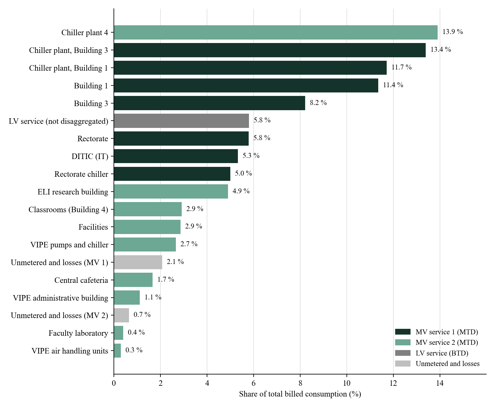
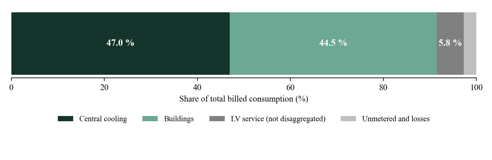
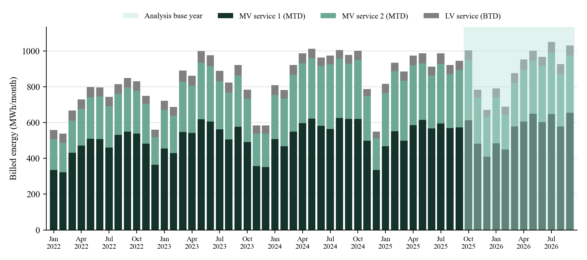
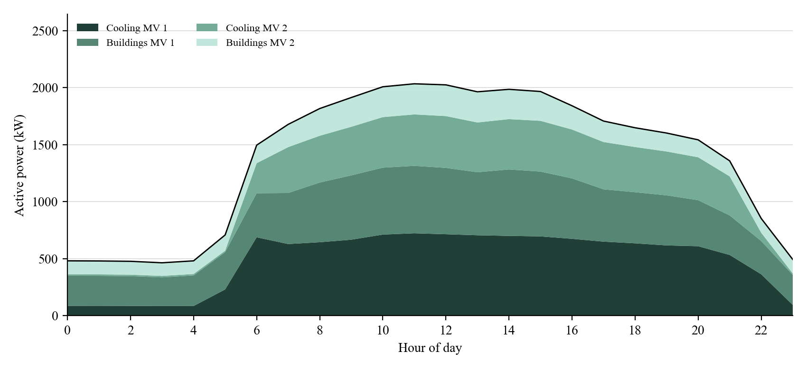
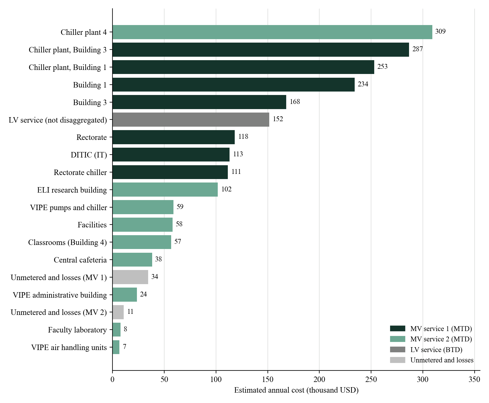

# Building-Level Energy Share & Cost, Víctor Levi Sasso Campus (UTP)

How much of the university's electricity bill belongs to each building? This repository answers that question for the main campus of the **Technological University of Panama (UTP)** by combining one-week power measurements per building with four years of utility billing.

The output is each building's share of campus consumption and its estimated electricity cost **per day, per month and per year**.

---

## Executive Summary

| Metric | Value |
|---|---|
| **Average campus consumption** (Oct 2025 to Sep 2026) | **895.2 MWh/month** |
| **Estimated electricity cost** | **USD 5,862/day · USD 178,437/month · USD 2.14 M/year** |
| **Central cooling share** (chiller plants, chillers, air handling units) | **47.0 % of consumption** |
| Energy balance closure, MV service 1 | 96.7 % of billed energy |
| Energy balance closure, MV service 2 | 97.9 % of billed energy |
| Metered points | 16 switchboards |

### Share and cost by building

| Building / system | Service | Share | USD/day | USD/month | USD/year |
|---|---|---:|---:|---:|---:|
| Chiller plant 4 | MV 2 | 13.9 % | 846 | 25,753 | 309,035 |
| Chiller plant, Building 3 | MV 1 | 13.4 % | 785 | 23,896 | 286,751 |
| Chiller plant, Building 1 | MV 1 | 11.7 % | 693 | 21,083 | 253,000 |
| Building 1 | MV 1 | 11.4 % | 641 | 19,506 | 234,067 |
| Building 3 | MV 1 | 8.2 % | 460 | 13,991 | 167,889 |
| LV service (not disaggregated) | LV | 5.8 % | 415 | 12,633 | 151,592 |
| Rectorate | MV 1 | 5.8 % | 323 | 9,846 | 118,152 |
| DITIC (IT) | MV 1 | 5.3 % | 310 | 9,424 | 113,089 |
| Rectorate chiller | MV 1 | 5.0 % | 305 | 9,289 | 111,463 |
| ELI research building | MV 2 | 4.9 % | 278 | 8,476 | 101,717 |
| VIPE pumps and chiller | MV 2 | 2.7 % | 161 | 4,899 | 58,786 |
| Facilities | MV 2 | 2.9 % | 159 | 4,833 | 57,994 |
| Classrooms (Building 4) | MV 2 | 2.9 % | 155 | 4,728 | 56,740 |
| Central cafeteria | MV 2 | 1.7 % | 105 | 3,181 | 38,175 |
| Unmetered and losses (MV 1) | MV 1 | 2.1 % | 94 | 2,860 | 34,317 |
| VIPE administrative building | MV 2 | 1.1 % | 64 | 1,960 | 23,525 |
| Unmetered and losses (MV 2) | MV 2 | 0.7 % | 29 | 892 | 10,701 |
| Faculty laboratory | MV 2 | 0.4 % | 21 | 641 | 7,697 |
| VIPE air handling units | MV 2 | 0.3 % | 18 | 546 | 6,555 |



---

## Campus Supply & Billing

The campus is served by three utility services from ENSA, Panama's regulated distribution company:

| Service | ASEP tariff | Loads |
|---|---|---|
| **MV 1** | MTD (medium voltage, demand) | Rectorate and its chiller, Building 1 and its chiller plant, DITIC, Building 3 and its chiller plant |
| **MV 2** | MTD | Faculty laboratory, ELI research building, Chiller plant 4, Classrooms (Building 4), Facilities, Central cafeteria, VIPE, Water building (under construction) |
| **LV** | BTD (low voltage, demand) | Standalone supply, no building-level metering |

Each monthly bill combines an **energy charge** (USD/kWh), a **maximum demand charge** (USD/kW), a fixed charge, a fuel adjustment, the Law 15 surcharge (0.42 %) and a credit from the Tariff Stabilization Fund (FET). The September 2026 invoice breaks down as follows:

| Concept (USD) | MV 1 | MV 2 | LV |
|---|---:|---:|---:|
| Energy | 102,586.56 | 50,025.03 | 10,973.02 |
| Maximum demand | 25,845.31 | 14,392.35 | 3,762.00 |
| Fixed charge + fuel adjustment + Law 15 | 588.93 | 299.86 | 73.67 |
| FET credit | −5,176.21 | −2,596.42 | −1,608.19 |
| **Total** | **123,844.59** | **62,120.82** | **13,200.50** |
| **Demand share of the bill** | **20.9 %** | **23.2 %** | **28.5 %** |



---

## Methodology

Each building was measured during a different week (March to September 2026; VIPE in July 2025), while campus consumption follows the academic calendar and the weather. The pipeline handles this in five steps.

**1. Hourly profile.** Each recording is averaged per hour and split into weekday, Saturday and Sunday.

**2. Typical week.**

$$E_{week} = 5\sum_h P_{weekday}(h) + \sum_h P_{sat}(h) + \sum_h P_{sun}(h)$$

When a recording misses the weekend, it is estimated with the median ratio of the other non-chiller buildings (Saturday 0.64, Sunday 0.63 of a weekday).

**3. Seasonal correction.** Each typical week is scaled to an average month using its own service's billing:

$$k = \frac{\text{average daily billed energy, base year}}{\text{daily billed energy during the measured days}}$$

$$E_{month} = E_{week} \cdot k \cdot \frac{30.44}{7}$$

**4. Energy balance.** The buildings on each service are added and compared with billed energy. Any shortfall is reported as *unmetered and losses*; an excess would scale the service down to 100 %.

**5. Cost allocation.** Each service's monthly cost is its average energy times the average price actually paid from July 2025 to June 2026 (USD 0.1953/kWh on MV 1, 0.1993 on MV 2, 0.2431 on LV). That cost is split in two parts:

$$C_i = C_{service} \cdot \left[(1-d)\, e_i + d\, p_i\right]$$

where $d$ is the demand share of the bill, $e_i$ the building's share of the service energy and $p_i$ its contribution to the service's weekday peak hour.

> [!NOTE]
> ENSA splits each day into demand intervals and bills, for each service, the highest average power recorded in any interval of the billing period. Since demand is only metered at the service level, each building's contribution to that peak is estimated from its typical weekday profile.

---

## Results

### Monthly billed energy, 2022 to 2026


### Typical weekday profile


The night base load (about 480 kW at 2:00) is held by the buildings themselves, mainly Building 1, Building 3, the Rectorate, the ELI research building and DITIC. Central cooling adds only about 100 kW at night and ramps up between 5:00 and 6:00.

### Annual cost by building


The full technical report (Spanish, Word and PDF) and a workbook with every table are in [`resultados/`](resultados).

---

## Repository Structure

```
.
├── code/
│   ├── preparar_datos.py     # Converts raw analyzer exports to hourly power
│   ├── analisis.py           # Typical week, seasonal factor, balance and cost allocation
│   ├── resultados.py         # Figures (English and Spanish) and Excel workbook
│   ├── informe.py            # Technical report in Word (Spanish)
│   └── run_all.py            # Runs the full pipeline
├── data/
│   ├── puntos.csv            # Metered points: building, service, end use, instrument
│   ├── mediciones/           # Hourly active power per point (kW)
│   └── facturacion/          # Monthly energy per service (MWh), amounts and Sep 2026 invoice breakdown
├── figures/                  # README figures
├── resultados/               # Report, workbook and Spanish figures
├── assets/
└── requirements.txt
```

---

## How to Reproduce

Requires Python 3.10+.

```bash
pip install -r requirements.txt
python code/run_all.py
```

`run_all.py` computes the allocation and writes the figures, the Excel workbook and the Word report. Update the table of contents in Word with F9.

To print the tables only:

```bash
python code/analisis.py
```

Hourly data is already included. To rebuild it from raw analyzer exports (Fluke Energy Analyze and WinPQ mobil):

```bash
python code/preparar_datos.py "path/to/raw/exports"
```

---

## Instrumentation

| Instrument | Logging interval |
|---|---|
| Fluke 1775 | 1 s, 10 s and 10 min |
| A-Eberle PQ-Box 150 | 10 min |
| A-Eberle PQ-Box 300 | 10 min |

## Limitations

- The central cafeteria has only 23 hours of data and carries the largest uncertainty.
- VIPE was measured in July and August 2025.
- The LV service has no building-level metering.
- Measurements are on the low-voltage side; transformer losses fall into *unmetered and losses*.

---

## Author

**Ing. Irving Nieto**, DINAGEA, Technological University of Panama.

## License

Code is released under the MIT License. Measurement and billing data belong to the Technological University of Panama and are shared for academic purposes. ASEP tariff schedules are public records.
